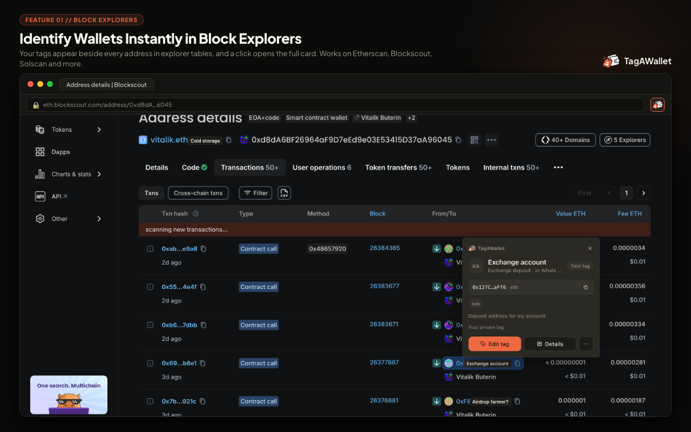
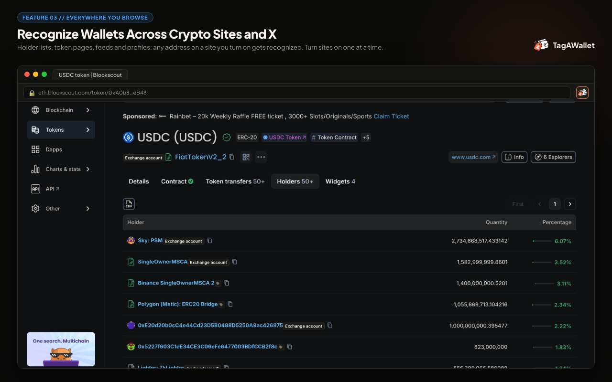
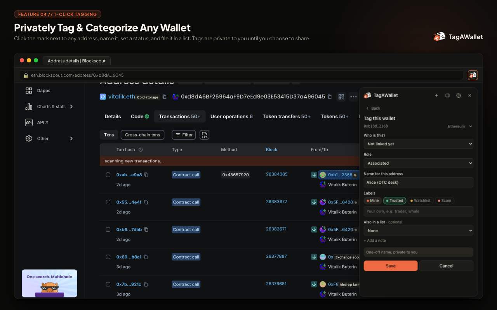

# TagAWallet

[](LICENSE)

**Know who’s behind every wallet.**

TagAWallet is a private-first wallet identity layer for crypto. Tag addresses, group them under people and projects, keep research in shareable lists, and recognize those identities as you browse — without ever touching seed phrases, private keys, or funds.

| Surface | What it is |
| --- | --- |
| **[Web dashboard](https://tagawallet.com)** | Organize wallets, people, projects, and lists. Publish verified profiles when you choose. |
| **Browser extension** | Chromium (Chrome, Brave, Edge). Detects addresses on explorers, X, DEX tools, and more — then shows your labels inline. |

TagAWallet is **not** a crypto wallet. It does not custody assets, request seeds or keys, or sign transactions for normal use.

<p align="center">
  
</p>

---

## Why it exists

Wallet addresses show up everywhere — explorers, X, trading UIs, research threads — and they’re hard to remember. Most tools optimize for trader analytics. TagAWallet is closer to a **wallet CRM**: private labels, entity grouping, and browser-native recognition with clear provenance for every claim.

**Private by default.** Your tags, notes, and lists stay yours unless you explicitly share or publish.

---

## Features

### Dashboard

- **People & projects** — group wallets under entities (individuals, projects, DAOs, exchanges, protocols, and more) with roles like treasury, hot, cold, or associated
- **Lists** — private working sets, or shared with teammates via invite (viewer / editor / admin)
- **Wallets** — multi-chain address book with tags, notes, status (`mine`, `watchlist`, `scam`, `trusted`, …), and official links
- **Search & import** — find across wallets, entities, and tags; import/export CSV or JSON
- **Public profiles** — optional published people (`/u/…`), projects (`/p/…`), and address pages (`/a/…`); private data never leaks onto them
- **Read-only API** — create keys in Settings and call `/api/v1/*` (docs at `/docs/api` when the app is running)
- **Auth** — email/password with required verification; optional Google and X OAuth when configured

### Extension

<p align="center">
  
  &nbsp;
  
</p>

- Detects **EVM, Solana, and Bitcoin** addresses, plus **ENS** (`.eth`) and **SNS** (`.sol`) in page text
- Inline **chips** next to addresses (badge, minimal, rail, or off) with provenance-aware labels
- **Floating panel or Chrome side panel** — wallets on this page, your library, and a quick-tag flow
- Toolbar **badge** for tagged / flagged counts on the current page
- Context menu and shortcuts (`Alt+Shift+T`, `Alt+Shift+P`)
- Works offline with a local tag queue; syncs when you’re back online
- **Least privilege** — no host access at install; content scripts run only on sites you enable
- **X privacy** — a handle index is downloaded and matched locally so the server never learns which profiles you view
- Curated defaults include Etherscan-family explorers, Solscan, mempool.space, X/Twitter, Dexscreener, DeBank, Zerion, Arkham, OpenSea, Farcaster, and more — admins can update the live list without shipping a new build

### Supported chains

Ethereum, Base, Arbitrum, Optimism, Polygon, BNB Chain, Solana, Bitcoin.

---

## Repository layout

```text
apps/web          Next.js dashboard, API, and public profiles
apps/extension    Manifest V3 extension (Vite + React panel)
packages/shared   Address detection, chains, schemas, curated sites
e2e               Playwright: API, web UI, and extension in Chromium
scripts           Local Mongo helper and Chrome Web Store asset tooling
```

| Stack | Pieces |
| --- | --- |
| Web | Next.js (App Router), React 19, Tailwind, Better Auth, MongoDB, Zod, Resend |
| Extension | Chrome MV3, Vite, React panel/options |
| Shared | Pure detection helpers + Zod schemas (`/lite` for content scripts) |

---

## Quick start

**Requirements:** Node.js 20+, [pnpm](https://pnpm.io) 12 (`packageManager` is pinned in `package.json`).

```bash
pnpm install
cp apps/web/.env.example apps/web/.env.local
```

Generate a secret and put it in `.env.local`:

```bash
openssl rand -base64 32
```

Minimum env for local work:

| Variable | Purpose |
| --- | --- |
| `MONGODB_URI` | Mongo connection (default in example targets local) |
| `APP_URL` | Public origin, e.g. `http://localhost:3000` |
| `BETTER_AUTH_SECRET` | Session secret |
| `BETTER_AUTH_URL` | Same origin people use to open the app |

Optional: `RESEND_API_KEY` / `EMAIL_FROM` (without a key, emails print to the server log), Google/X OAuth keys, `ETH_RPC_URL` for ENS, `ADMIN_EMAILS`, `NEXT_PUBLIC_EXTENSION_STORE_URL`.

### Run the dashboard

```bash
# Terminal 1 — local MongoDB (data under .dev-db)
pnpm dev:db

# Terminal 2 — app
pnpm dev
```

Open [http://localhost:3000](http://localhost:3000). Sign up, confirm the email link from the server log if Resend isn’t configured, then open the dashboard.

### Load the extension

```bash
pnpm --filter @tagawallet/extension build
```

1. Open `chrome://extensions`
2. Enable **Developer mode**
3. **Load unpacked** → `apps/extension/dist`
4. In the extension, connect to your local app and enable the sites you care about

Point the build at another API host when needed:

```bash
# Production API
TAW_RELEASE=1 pnpm --filter @tagawallet/extension build

# Custom host (must match APP_URL)
TAW_API_BASE=https://example.com pnpm --filter @tagawallet/extension build
```

---

## Development

```bash
pnpm typecheck
pnpm test                 # unit tests (shared package)
pnpm build                # web + extension production builds
pnpm test:e2e             # Playwright against the production build
```

Useful paths once the app is running:

| Path | Purpose |
| --- | --- |
| `/dashboard` | Signed-in home |
| `/docs/api` | Read-only HTTP API docs |
| `/admin/sites` | Extension site allowlist (admins) |
| `/privacy`, `/terms` | Legal |
| `/extension` | Install / connect helpers |

Product intent and MVP scope are spelled out in [`tagawallet-prd.md`](tagawallet-prd.md).

---

## Deploying

**Web** — deploy `apps/web` with `MONGODB_URI`, `APP_URL`, `BETTER_AUTH_SECRET`, `BETTER_AUTH_URL`, and `ADMIN_EMAILS` set, plus any OAuth/email keys you use. In production, `APP_URL` and `BETTER_AUTH_URL` should match the public origin people actually use (including `www` if that’s the live host).

**Extension** — ship a `TAW_RELEASE=1` (or `TAW_API_BASE=…`) build whose API origin matches `APP_URL`. Store listing screenshots and promos live under `apps/extension/store-assets/`; regenerate with `pnpm generate:store-assets`.

**Install CTAs** — home-page “Add to Chrome” buttons use `NEXT_PUBLIC_EXTENSION_STORE_URL`. Until that URL is set, they fall through to `/extension`.

---

## Security & privacy

- Private tags, notes, and lists are private by default
- Public pages only show explicitly published claims
- The extension requests minimal permissions and only injects on sites you enable
- On X, profile matching happens on-device against a downloaded handle index
- Every visible label carries provenance (private, shared, self-claimed, verified, …)
- Account deletion wipes associated personal data

If you find a vulnerability, please report it privately to the maintainers rather than opening a public issue with exploit details.

---

## Contributing

Issues and pull requests are welcome. For larger changes, open an issue first so we can align on direction.

1. Fork and clone
2. `pnpm install` and run `pnpm dev:db` + `pnpm dev`
3. Keep changes focused; run `pnpm typecheck` and relevant tests before opening a PR

---

## License

[MIT](LICENSE) — free to use, copy, modify, and distribute, with attribution.

---

## Links

- Website: [tagawallet.com](https://tagawallet.com)
- Product requirements: [`tagawallet-prd.md`](tagawallet-prd.md)
